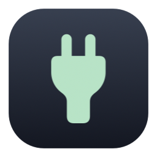
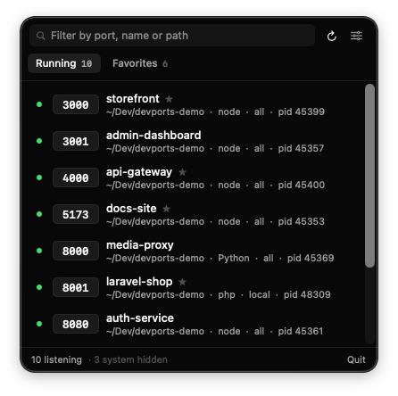

<p align="center">
  
</p>

<h1 align="center">DevPorts</h1>

<p align="center">
  <strong>A macOS menu bar app for the ports you forgot you left running.</strong>
</p>

<p align="center">
  
  
  
  
  <a href="LICENSE"></a>
</p>

<p align="center">
  <a href="https://github.com/kncerdas/macos-dev-ports-manager/releases/latest/download/DevPorts.dmg">
    
  </a>
  <br>
  <sub>macOS 15 or later · <a href="https://github.com/kncerdas/macos-dev-ports-manager/releases">All releases</a></sub>
</p>

<p align="center">
  
</p>

You have five projects open across terminal tabs. Something says `EADDRINUSE` on port 3000,
and you can't tell which project owns it. DevPorts lists every listening port, shows which
project each one belongs to, and gives you a button for each fix you'd otherwise do by hand
in the terminal.

---

## Features

| | |
| --- | --- |
| 🔌 **See what's listening** | Every TCP port in `LISTEN`, refreshed live while the panel is open. Filter by port, name or path. |
| 🏷️ **Real names** | A row says `AI Coach`, not `/Users/you/Dev/AI Coach/node_modules/.bin/next`. Rename anything; names survive restarts and new PIDs. |
| ⏹️ **Stop safely** | Before anything is killed, Stop lists the exact PIDs it will signal. Choose **Stop Process** or **Stop Tree**, which also ends the `npm run dev` wrapper left behind. |
| ▶️ **Start & restart** | Star a port to save its command and folder. Start it again later, even after a reboot. Restart waits for the port to clear before starting again. |
| 🐳 **Docker aware** | Published container ports show the container, not Docker's shared forwarder, and stop and restart through `docker`. |
| 🙈 **Hide the noise** | System daemons are hidden by default. Hide any other process from its `⋯` menu, and show or hide them all from the footer in one click. |
| 🌐 **Open in browser** | One click to `http://localhost:<port>`, with an `http`/`https` choice per entry. |
| 🚀 **Open at login** | One toggle in the settings menu, and DevPorts is in your menu bar every time you log in. |
| 🪶 **Lightweight** | Native SwiftUI + AppKit, no third-party dependencies, no Dock icon. It lives in the menu bar. |

---

## Install

### Download

1. Download **[DevPorts.dmg](https://github.com/kncerdas/macos-dev-ports-manager/releases/latest/download/DevPorts.dmg)**
   (always the latest release).
2. Open it and double-click **DevPorts**. It offers to install itself into `/Applications`.
   You can also drag it onto the Applications shortcut.
3. **First launch only:** the build isn't notarized yet, so macOS blocks it the first time.
   Open **System Settings → Privacy & Security**, scroll down, and click **Open Anyway**
   next to the DevPorts message. After that it opens normally.

Look for the plug icon in the menu bar. DevPorts has no Dock icon.

### Updating

Download the new `DevPorts.dmg`, open it and double-click **DevPorts**. It quits the running
version, replaces the copy in `/Applications` and relaunches. You never have to delete the
old app first, and your favorites and settings carry over.

### From source

```bash
git clone https://github.com/kncerdas/macos-dev-ports-manager.git
cd macos-dev-ports-manager
make install          # builds and copies DevPorts.app to /Applications
```

Requires macOS 15 or later and Swift 6 (Xcode or the command line tools).

Other targets:

```bash
make run              # build ./DevPorts.app and launch it
make dmg              # build a disk image in dist/
swift run DevPorts    # run straight from SwiftPM while hacking
```

---

## Using it

- **Click the plug in the menu bar** to open the panel. **Running** lists everything
  listening. **Favorites** lists servers you've saved, whether running or not.
- **Hover a row** to show its actions: open, restart, stop, star, and the `⋯` menu with
  rename, copy PID, reveal in Finder, view log and hide.
- **Star a running server** to save it. DevPorts fills in the start command for you; for Node
  projects it reads `package.json` and the lockfile (`pnpm run dev`, `npm run start`, …).
  Check it, save it, and the server can be started from the panel later.
- **Open at login**: turn on **Open at Login** in the settings menu (the sliders icon). You
  can also manage it in **System Settings → General → Login Items**.
- **Hidden processes**: the footer shows how many are hidden (`· 4 hidden`). Click to show
  them, and click `· hide 4` to hide them again. The `⋯` menu can un-hide a single process.

Servers DevPorts starts run fully detached, so quitting DevPorts leaves them running. Their
output goes to a per-favorite log you can open from the row.

---

## How it works

### Recovering the real start command

This was the hard part. Node rewrites its process title, so the server on port 3000 reports
itself as `next-server (v16.2.6)`, which is no use for restarting it. DevPorts walks up the
process tree to the topmost runtime ancestor, which still carries `next dev --turbopack`. It
then rewrites absolute paths relative to the project directory, so a path containing a space
doesn't split apart when the command is replayed. When it still can't produce something
trustworthy, it asks you to check the command instead of guessing.

### The port a server actually binds

A favorite's port is exported to its command as `PORT`, the convention Next, CRA, Express,
Rails and most dev servers read. A port hard-coded in config (`server.port` in
`vite.config.js`, `next dev -p 3000`) still wins, so DevPorts watches where the server
*actually* lands and tells you:

> "storefront ignored $PORT and started on 5173 instead of 4000."

The row shows `saved :4000` next to the live port, and the `⋯` menu offers **Save Port
5173** to make that the saved port. The server is matched to its favorite by working directory,
so it never splits into two rows.

### Stopping

DevPorts sends SIGTERM first, then SIGKILL after a 3-second grace period. Tick *Remember* and
that favorite skips the prompt next time.

---

## Privacy & permissions

DevPorts is a local developer tool. It makes no network requests and collects no telemetry.

It isn't sandboxed. It needs to run `lsof` and `ps`, send signals to your processes and
start login shells in your project folders, and the App Sandbox allows none of that.

Everything it stores lives in `~/Library/Application Support/DevPorts/`:

| Path | Contents |
| --- | --- |
| `store.json` | favorites, renames, hidden processes, settings |
| `logs/<favorite-id>.log` | output of servers DevPorts started |

Delete that folder to reset the app completely.

---

## Signing & Gatekeeper

Releases are currently **ad-hoc signed**, not notarized. That's why a downloaded copy needs
**Open Anyway** once in **System Settings → Privacy & Security**. A build made on your own
machine doesn't need this; macOS only quarantines files that arrive from somewhere else.

To ship a build that opens normally, sign it with a Developer ID and notarize it. Both are
already wired into the script; both need a paid Apple Developer account:

```bash
# one-time: store an app-specific password in the keychain
xcrun notarytool store-credentials devports \
  --apple-id you@example.com --team-id TEAMID --password <app-specific-password>

DEVPORTS_SIGN_ID="Developer ID Application: Your Name (TEAMID)" \
DEVPORTS_NOTARY_PROFILE=devports make dmg
```

That signs the app with the hardened runtime, signs the image, waits for Apple's verdict and
staples the ticket so it opens offline.

---

## Development

### Debugging the scanner

```bash
swift run DevPorts --scan
```

Prints what the scanner sees without opening the UI: port, PID, which ancestor the command
was recovered from, the resolved directory, and whether the command is safe to replay:

```
dev 3000	node	pid=58650 src=58649 bind=*
	dir: /Users/you/Dev/AI Coach
	cmd: node node_modules/.bin/next dev --turbopack  [verified: true]
```

Compare against `lsof -nP -iTCP -sTCP:LISTEN` when something looks off.

### Project layout

| File | Job |
| --- | --- |
| `Service/PortScanner.swift` | parses `lsof -F` output, collapses IPv4/IPv6 duplicates |
| `Service/ProcessInspector.swift` | process table, ancestor walk, cwd, system classification, `package.json` suggestions |
| `Service/ProcessController.swift` | SIGTERM→SIGKILL escalation, detached launch, port polling |
| `Service/DockerInspector.swift` | maps published ports to containers, `docker stop`/`restart` |
| `Service/SelfInstaller.swift` | install-or-update when launched from the disk image |
| `Service/Store.swift` | debounced, atomic JSON persistence |
| `ViewModel/PortsViewModel.swift` | scan → row merge, favorites, every action |
| `View/` | menu bar panel, rows, inline stop confirmation, editor window |

Some design decisions, if you're reading the code:

- **Two `ps` calls, not one.** Each requests a single space-containing field (`comm`, then
  `command`) in trailing position, which keeps parsing unambiguous for paths with spaces.
- **One batched `lsof` for working directories.** `-p` takes a comma list, so enriching
  twenty listeners is still one process spawn.
- **Editing happens in a real window, not a sheet.** A sheet attached to a menu bar panel
  dismisses the panel the moment focus moves.
- **Stop confirmation is inline, not a popover**, for the same reason.

---

## Limits

- Without root, `lsof` only reports **your own** processes. Ports held by root daemons show up
  only with *Show hidden processes* on, and can't be stopped from the app. If you try, the
  app tells you why it can't.
- Start and restart need a saved favorite, because that's where the command lives. Stop
  works on anything you own. Docker containers can be restarted without a favorite.

---

## License

[MIT](LICENSE) © 2026 nullkyu
